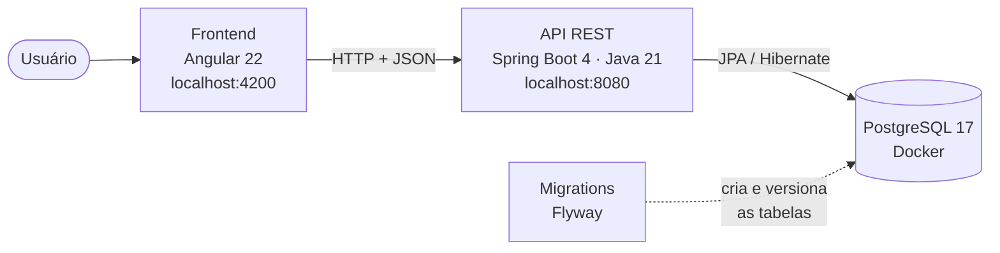
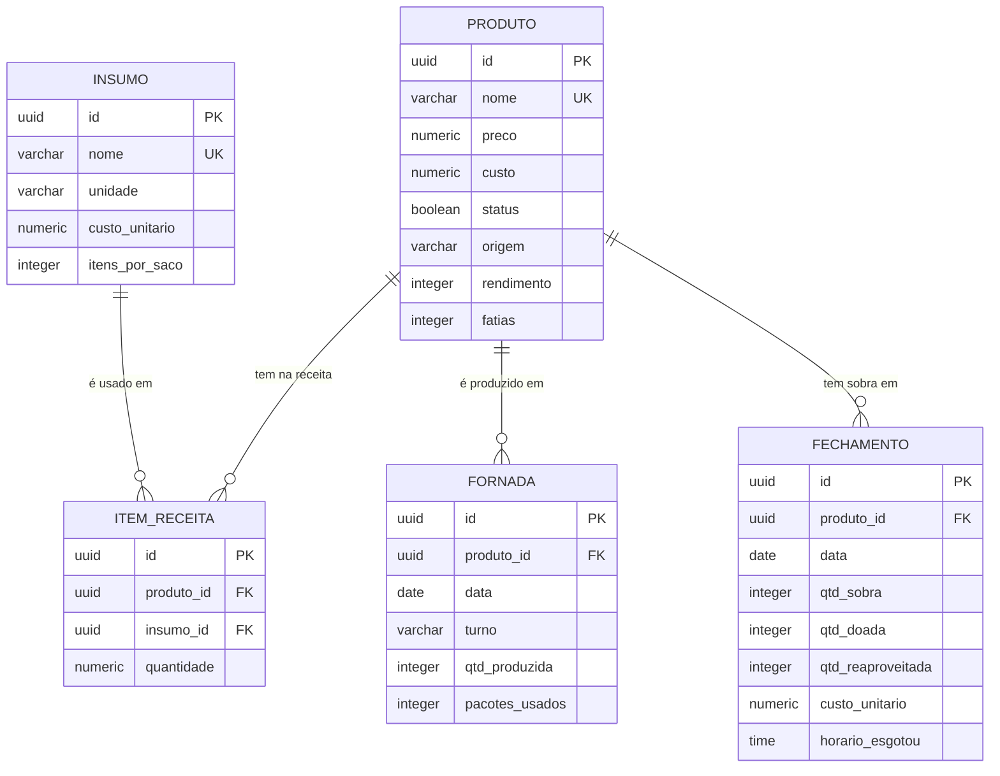
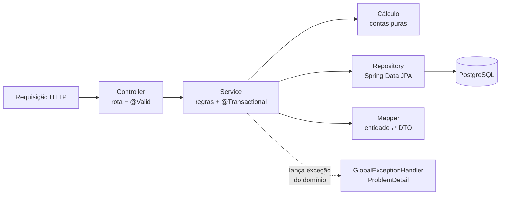
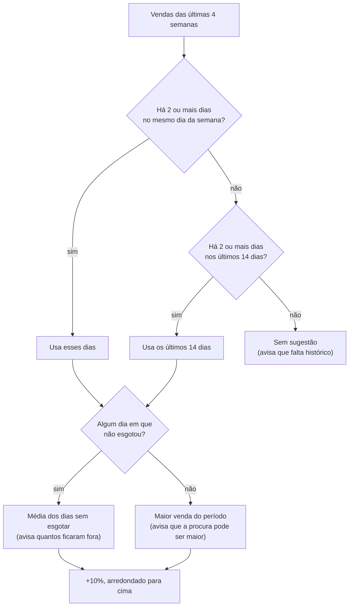

# Fornada Certa — Documentação do projeto

> Sistema web para reduzir o desperdício em padarias: registra a produção, as sobras e o custo da perda, e sugere quanto produzir no dia seguinte.

**Autor:** Eric Lopes Winkelmann · Análise e Desenvolvimento de Sistemas — Universidade Cruzeiro do Sul
**Atualizado em:** 16/11/2026

## Sumário

1. [Visão geral](#1-visão-geral)
2. [Arquitetura e tecnologias](#2-arquitetura-e-tecnologias)
3. [Modelo de dados](#3-modelo-de-dados)
4. [Backend: camadas e responsabilidades](#4-backend-camadas-e-responsabilidades)
5. [Regras de negócio](#5-regras-de-negócio)
6. [API REST](#6-api-rest)
7. [Frontend](#7-frontend)
8. [Testes e qualidade](#8-testes-e-qualidade)
9. [Como rodar o projeto](#9-como-rodar-o-projeto)
10. [Limitações e próximos passos](#10-limitações-e-próximos-passos)

---

## 1. Visão geral

O Fornada Certa ajuda uma padaria a produzir a quantidade certa de cada produto. Ele registra o que foi assado e o que sobrou no fim do dia, calcula quanto isso custou e sugere a próxima fornada com base no histórico de vendas.

**O problema.** Padarias produzem por estimativa. Quando a estimativa erra para cima, o que sobra vira desperdício: ingrediente pago e jogado fora. Quando erra para baixo, falta produto e a venda se perde. Sem registro, ninguém sabe quanto se perde por dia nem em quais produtos.

**O que o sistema faz:**

- **Produtos e ficha técnica:** cadastro dos produtos com preço de venda e receita (insumos e quantidades), de onde sai o custo de cada item.
- **Insumos:** cadastro dos ingredientes (farinha, leite, ovos…) e dos sacos de massa comprados de fornecedores, com o custo por unidade e, nos sacos, quantos itens vêm em cada um.
- **Venda em fatias:** bolos, pudins e tortas podem ser vendidos por fatia, com preço e custo por fatia.
- **Fornada do dia:** registro de quanto foi produzido de cada produto, por turno.
- **Fechamento do dia:** registro das sobras; o sistema calcula o vendido, o descartado e o custo do desperdício.
- **Painel:** indicadores da semana, gráfico de vendas e descarte, ranking do desperdício e sugestão de produção para amanhã.

**Fora do escopo:** controle de estoque de insumos, ponto de venda (caixa), login de usuários e várias lojas. A seção 10 explica o porquê.

---

## 2. Arquitetura e tecnologias

O sistema tem três partes: um front em Angular que roda no navegador, uma API REST em Spring Boot que concentra todas as regras, e um banco PostgreSQL. O front só mostra e coleta dados; quem decide se algo é válido é sempre a API.



| Decisão | Escolha | Por quê |
| --- | --- | --- |
| Linguagem do backend | Java 21 | É a linguagem estudada no curso e é uma versão LTS (suporte longo). Records deixam DTOs curtos e imutáveis. |
| Framework do backend | Spring Boot 4 (Web MVC, Data JPA, Validation) | Padrão de mercado para APIs em Java. Já traz servidor web, injeção de dependências, validação e acesso ao banco, sem configuração manual. |
| Build | Gradle com Kotlin DSL | Build mais rápido que o Maven (cache incremental) e script com autocompletar e checagem de tipos na IDE. |
| Empacotamento | `.jar` executável | O Spring Boot já embute o servidor (Tomcat). Um `.war` só faria sentido para publicar num servidor de aplicação externo, que o projeto não usa. |
| Banco de dados | PostgreSQL 17 | Relacional, gratuito, com `CHECK`, `UNIQUE` e chaves estrangeiras que garantem as regras também no banco. Os dados (produto, fornada, fechamento) são naturalmente tabelas relacionadas. |
| Versão do banco | Flyway | Cada mudança de estrutura é um arquivo SQL numerado (V1, V2…). Qualquer máquina recria o banco igual, e o histórico das mudanças fica no Git. |
| Banco local | Docker Compose | Um arquivo descreve o Postgres com usuário e senha; ninguém precisa instalar o banco. O Spring Boot sobe o container sozinho ao iniciar (`spring-boot-docker-compose`). |
| Frontend | Angular 22 com componentes standalone e signals | Framework completo (rotas, formulários, HTTP) com TypeScript, que dá checagem de tipos parecida com a do Java. Signals deixam o estado da tela simples de acompanhar. |
| Repositório | Monorepo (`backend/` e `frontend/` juntos) | Uma mudança que mexe na API e na tela vai num commit só, e quem clona o projeto tem tudo de uma vez. |
| Comunicação | REST com JSON | Simples de testar (navegador, Postman, MockMvc) e o formato que o Angular consome direto. |

**Por que a regra fica no backend.** Se a validação morasse só na tela, qualquer chamada direta à API passaria por cima dela. O front valida para dar resposta rápida ao usuário, mas a API valida de novo e tem a palavra final. O banco ainda tem uma terceira barreira (constraints) para o caso de algum bug escapar das duas primeiras.

---

## 3. Modelo de dados

São cinco tabelas. `produto` e `insumo` são cadastros; `item_receita` liga os dois (é a ficha técnica); `fornada` e `fechamento` são os lançamentos do dia. Venda e descarte não são gravados: são calculados a partir da produção e da sobra.



| Tabela | Guarda | Regras no banco |
| --- | --- | --- |
| `produto` | O que a padaria vende: nome, preço, custo, se está ativo, origem (produção própria ou fornecedor), rendimento e, se for vendido em fatias, quantas fatias tem cada unidade | Nome único; custo ≥ 0; rendimento > 0; fatias ≥ 2 |
| `insumo` | Ingredientes e sacos de massa de fornecedor, com unidade (KG, L, UN, SACO), custo por unidade e, nos sacos, quantos itens vêm em cada um | Nome único; unidade só entre as quatro; custo ≥ 0; itens por saco só em insumo do tipo SACO |
| `item_receita` | Quanto de cada insumo entra em um produto (3 casas decimais) | Quantidade > 0; o mesmo insumo só uma vez por produto |
| `fornada` | Quanto foi produzido por produto, dia e turno (MANHA, TARDE), e quantos pacotes foram usados | Uma fornada por produto, dia e turno; quantidade > 0 |
| `fechamento` | O que sobrou por produto e dia, quanto foi doado ou reaproveitado, o custo do dia e a hora em que esgotou | Um fechamento por produto e dia; doado + reaproveitado ≤ sobra; horário de esgotar só com sobra zero |

### Decisões e por quê

- **Chave primária UUID em vez de número sequencial.** O id não revela quantos registros existem, não deixa "adivinhar" o próximo na URL e pode ser gerado sem consultar o banco.
- **Desativar em vez de excluir produto.** Excluir um produto apagaria (ou quebraria) as fornadas e os fechamentos antigos. Com `status = false` ele some da fornada do dia e da sugestão, mas o histórico e os relatórios continuam corretos.
- **Dinheiro em `NUMERIC(10,2)` e `BigDecimal`.** `double` erra centavos em contas como 0,1 + 0,2. `NUMERIC` guarda o valor exato, e o `BigDecimal` mantém essa exatidão no Java.
- **Fornada por turno.** A padaria assa de manhã e à tarde. Separar os turnos permite lançar cada um na hora em que acontece; o total do dia é a soma dos dois.
- **`pacotes_usados` opcional.** Para produtos de fornecedor (ex.: pão francês de saco) é útil anotar quantos sacos foram abertos; nos outros o campo fica vazio.
- **Itens por saco no cadastro do saco, e não no produto.** É uma característica do saco que o fornecedor entrega. Se o fornecedor mudar a quantidade, basta editar o saco e todos os produtos que o usam têm o custo recalculado.
- **Fatias no produto, quantidades em fatias.** Para um bolo vendido em fatias, a fornada, o fechamento e a sugestão contam fatias, porque é nessa unidade que se vende e que sobra. Só a tela da fornada pede unidades inteiras e converte (3 bolos × 12 = 36 fatias).
- **Fechamento com `custo_unitario` copiado.** O custo do produto muda quando um insumo encarece. Se o fechamento só apontasse para o produto, o desperdício de meses atrás seria recalculado com o preço de hoje. Copiando o custo no momento do fechamento, o relatório de um dia passado nunca muda.
- **Sobra dividida em doada, reaproveitada e descartada.** Só o descartado é perda real. O que foi doado ou virou outro produto (pão velho em farinha de rosca, por exemplo) não entra no custo do desperdício.
- **`horario_esgotou`.** Quando o produto acaba antes do fim do dia, a venda registrada é menor que a procura real. Guardar o horário permite que a sugestão trate esses dias de outro jeito (seção 5).
- **Venda e descarte calculados, não gravados.** Vendido = produzido − sobra; descartado = sobra − doado − reaproveitado. Gravar esses números criaria duas fontes da verdade, que poderiam ficar diferentes depois de uma correção.
- **Custo do produto guardado na tabela, mesmo sendo calculado pela ficha.** Fornada, fechamento e painel leem `produto.custo` direto, sem refazer a conta da receita a cada consulta. O valor é recalculado sempre que a receita ou o preço de um insumo muda.
- **Regras repetidas no banco (`CHECK`, `UNIQUE`).** A API já valida tudo, mas o banco é a última barreira: nem um bug nem um `INSERT` manual conseguem gravar sobra negativa ou dois fechamentos para o mesmo dia.

### Migrations

A estrutura é criada só pelo Flyway, e o Hibernate roda com `ddl-auto: validate`: ele confere se as entidades batem com as tabelas, mas nunca altera o banco. Assim, toda mudança de estrutura está num arquivo versionado.

| Arquivo | O que faz |
| --- | --- |
| `V1__criar_tabela_produto.sql` | Cria `produto` com nome, preço e status |
| `V2__adicionar_custo_em_produto.sql` | Adiciona o custo do produto |
| `V3__criar_tabelas_fornada_e_fechamento.sql` | Cria `fornada` e `fechamento` com todas as constraints |
| `V5__criar_ficha_tecnica.sql` | Cria `insumo` e `item_receita` e adiciona `origem` e `rendimento` ao produto |
| `V6__adicionar_itens_por_saco_e_fatias.sql` | Adiciona `itens_por_saco` ao insumo (preenchido a partir dos produtos de fornecedor que já existiam) e `fatias` ao produto |

Uma migration aplicada nunca é editada: o Flyway guarda um checksum de cada arquivo e recusa subir se ele mudar. Correções entram sempre como um arquivo novo. As migrations de dados de exemplo (a V4 e a primeira V6) foram removidas antes de chegarem ao banco de produção para o banco começar vazio e receber dados reais; o salto na numeração não atrapalha o Flyway.

---

## 4. Backend: camadas e responsabilidades

O backend é organizado em camadas, cada uma com um único trabalho. A requisição entra pelo controller, desce até o banco e volta, e nenhuma camada pula a outra.



| Pacote | Responsabilidade | Exemplo |
| --- | --- | --- |
| `controller` | Recebe a requisição HTTP, aciona a validação (`@Valid`) e devolve o status certo (201, 200, 204). Não tem regra de negócio. | `ProdutoController` |
| `dto` | Formato do que entra e sai da API, em `record`. Separa o contrato da API da estrutura do banco. | `ProdutoRequest`, `ProdutoResponse` |
| `mapper` | Converte DTO em entidade e entidade em DTO. | `ProdutoMapper` |
| `service` | Regras de negócio e transações. É aqui que se decide se algo pode ou não ser feito. | `FechamentoService` |
| `calculo` | Contas puras, sem banco nem web: custo por item e sugestão de produção. | `CalculadoraCusto`, `CalculadoraSugestao` |
| `repository` | Acesso ao banco com Spring Data JPA (métodos pelo nome e `@Query`). | `FornadaRepository` |
| `entity` | Classes mapeadas para as tabelas (JPA). | `Produto`, `Fechamento` |
| `exception` e `handler` | Exceções do domínio e o tradutor delas para respostas HTTP. | `RegraDeNegocioException`, `GlobalExceptionHandler` |
| `config` | Configurações da aplicação. | `CorsConfig` (libera o front em `localhost:4200`) |

### O caminho de uma requisição

Exemplo: o usuário registra o fechamento do dia.

1. O Angular envia `POST /fechamento` com a lista de sobras em JSON.
2. O `FechamentoController` recebe o corpo como `FechamentoLoteRequest`, e o `@Valid` confere campos obrigatórios e números negativos. Se algo estiver errado, responde 400 sem chamar o service.
3. O `FechamentoService` aplica as regras (dia futuro, produto repetido, sobra maior que a produção…) consultando os repositories.
4. O `FechamentoMapper` cria as entidades, copiando o custo atual de cada produto.
5. O repository grava tudo numa transação (`@Transactional`): ou grava o lote inteiro, ou não grava nada.
6. O mapper converte as entidades em `FechamentoResponse` (já com descartado e custo do descarte) e o controller responde 201.

### Decisões e por quê

- **DTO separado da entidade.** Se a API devolvesse a entidade direto, todo campo novo no banco vazaria para o cliente, e relacionamentos JPA poderiam entrar em laço na conversão para JSON. Com DTO, o formato da API só muda quando se decide mudá-lo.
- **`record` nos DTOs.** São imutáveis e já vêm com construtor, getters, `equals` e `toString`.
- **Mapper como classe própria.** Tira a conversão do service, que fica só com as regras, e pode ser testado sozinho.
- **Cálculos em classes puras (`calculo`).** As contas de custo e de sugestão são o coração do sistema. Separadas, são testadas com valores conhecidos sem subir Spring nem banco.
- **Lançamento em lote.** Fornada e fechamento chegam como uma lista de produtos de uma vez, porque é assim que a tela funciona. A transação garante que um erro no quinto produto não deixe os quatro primeiros gravados.
- **PATCH para edição.** O cliente manda só o que mudou (por exemplo, só `status` no botão de ativar). Campos ausentes chegam como `null` e são ignorados. A alteração vai para o banco pelo *dirty checking* do JPA: dentro da transação, alterar a entidade já basta, sem chamar `save`.
- **Injeção por construtor (`@RequiredArgsConstructor`).** As dependências ficam `final`, e nos testes basta passar mocks no construtor.
- **`@EntityGraph` nas consultas de listagem.** Carrega o produto junto com a fornada ou o fechamento numa consulta só, evitando o problema N+1 (uma consulta extra para cada linha).
- **Fuso fixo `America/Sao_Paulo`.** "Hoje" é sempre o dia da padaria, mesmo que o servidor esteja em outro fuso.

---

## 5. Regras de negócio

O dia da padaria tem dois lançamentos: a fornada (o que foi produzido, por turno) e o fechamento (o que sobrou). Desses dois números saem a venda, o desperdício, o custo da perda e a sugestão do dia seguinte.

### Cálculos do dia

- **Produzido no dia** = soma das fornadas da manhã e da tarde
- **Vendido** = produzido − sobra
- **Descartado** = sobra − doado − reaproveitado
- **Custo do desperdício** = descartado × custo unitário gravado no fechamento
- **Taxa de desperdício** = descartado ÷ produzido

Exemplo: 300 pães produzidos, 40 de sobra, 10 doados e 5 reaproveitados. Vendidos = 260; descartados = 25. Com custo de R$ 0,35, a perda do dia é R$ 8,75 e a taxa é 8,3%.

### Fornada

| Regra | Se for violada | Por quê |
| --- | --- | --- |
| A data vai no máximo até amanhã (sem data = hoje) | 422 | Permite planejar a produção da madrugada seguinte, mas impede lançar um futuro distante por engano. |
| O mesmo produto não aparece duas vezes no lote | 422 | Evita somar duas linhas sem querer. |
| O produto precisa existir e estar ativo | 404 / 422 | Produto desativado não é mais produzido. |
| Só uma fornada por produto, dia e turno | 409 | Para corrigir, edita-se a fornada existente em vez de lançar outra. |
| Editar ou excluir não pode deixar a produção do dia menor que a sobra já fechada | 422 | Senão a venda calculada ficaria negativa. A mensagem pede para corrigir o fechamento antes. |

### Fechamento

| Regra | Se for violada | Por quê |
| --- | --- | --- |
| Não se fecha um dia que ainda não aconteceu | 422 | Sobra só existe depois do expediente. |
| Só um fechamento por produto e dia | 409 | O fechamento é a foto final do dia. |
| Precisa ter havido fornada do produto naquele dia | 422 | Sem produção não há o que sobrar. |
| A sobra não passa do total produzido no dia | 422 | Não dá para sobrar mais do que foi feito. |
| Doado + reaproveitado ≤ sobra | 422 | Só se doa ou reaproveita o que sobrou. |
| Horário em que esgotou só quando a sobra é zero | 422 | Se sobrou, o produto não esgotou. |
| O custo do produto é copiado para o fechamento | — | Mantém o custo histórico do desperdício (seção 3). |
| Produto de fornecedor: o custo do dia vem dos sacos usados | — | Se um saco veio com menos pães, cada pão custou mais naquele dia (abaixo). |

**Custo real do saco.** Às vezes um saco do fornecedor vem com menos pães que o normal. Por isso, na fornada de um produto de fornecedor, informa-se quantos sacos foram usados e quantos pães realmente saíram. No fechamento, o custo do dia é calculado assim:

```
custo do dia = Σ (sacos usados × preço do saco) ÷ pães produzidos no dia
```

Exemplo: 2 sacos de R$ 28,00 deveriam dar 160 pães, mas saíram 140. O custo do dia é R$ 56,00 ÷ 140 = R$ 0,40 por pão, e não os R$ 0,35 do cadastro; o desperdício daquele dia é calculado com R$ 0,40. Um turno lançado sem a quantidade de sacos entra pelo custo do cadastro.

### Relatório do painel

Sem datas, o relatório cobre os 7 dias que terminam ontem, porque hoje ainda não foi fechado. Ele traz os totais do período, os números de cada dia (para o gráfico) e os produtos ordenados pelo custo do descarte, do maior para o menor, para mostrar primeiro onde está o dinheiro perdido. O painel compara a semana com a anterior.

### Sugestão de produção

Para cada produto ativo, a sugestão para amanhã olha as vendas das últimas 4 semanas e segue esta ordem:



1. **Mesmo dia da semana.** Se houver pelo menos 2 dias fechados no mesmo dia da semana do alvo (as segundas, para sugerir uma segunda), usa esses dias. A padaria vende diferente no sábado e na terça, então comparar segunda com segunda é mais justo.
2. **Últimos 14 dias.** Se não houver segundas suficientes (um produto novo, por exemplo), usa os dias fechados das últimas duas semanas.
3. **Sem histórico.** Com menos de 2 dias, não sugere nada e avisa. Um único dia não é base confiável.
4. **Dias em que esgotou ficam fora da média.** Nesses dias a venda foi limitada pela produção, não pela procura; incluí-los puxaria a sugestão para baixo. A tela avisa quantos dias foram ignorados. Se esgotou em todos, usa a maior venda e avisa que a procura pode ser maior.
5. **Margem de 10%, arredondada para cima.** Cobre a variação normal de um dia para outro. Arredondar para cima evita sugerir 112,2 pães.

Exemplo: nas últimas quatro segundas o pão francês vendeu 100, 110 e 96, e numa delas esgotou. A média sem o dia esgotado é 102; com 10% dá 112,2; a sugestão é **113**, com o aviso de que 1 dia ficou fora da média.

**Por que média, e não algo mais sofisticado.** A média por dia da semana é fácil de explicar ao padeiro ("nas últimas segundas você vendeu em média 102") e funciona com pouco histórico. Modelos estatísticos de previsão precisariam de meses de dados e seriam uma caixa-preta para quem usa.

### Ficha técnica e custo do produto

O custo de cada item vem da receita: a soma de quantidade × custo de cada insumo, dividida pelo rendimento.

```
custo por item = Σ (quantidade × custo do insumo) ÷ (rendimento × fatias)
```

Quando o produto não é vendido em fatias, fatias vale 1.

- **Produção própria:** a receita lista os insumos e quanto de cada um. Ex.: 1 kg de polvilho (R$ 9,00) + 0,5 kg de queijo (R$ 24,00) + 0,5 L de leite (R$ 3,00) + 4 ovos (R$ 3,20) + 0,2 L de óleo (R$ 1,80) = R$ 41,00; rendendo 30 pães de queijo, dá R$ 1,37 cada.
- **Fornecedor:** a padaria compra a massa pronta em sacos. A ficha tem exatamente um insumo do tipo SACO, e o rendimento é a quantidade de itens cadastrada no saco. Ex.: saco de R$ 28,00 que vem com 80 pães = R$ 0,35 por pão.
- **Vendido em fatias:** o rendimento é em unidades inteiras e o produto informa quantas fatias tem cada unidade. O custo e o preço passam a ser por fatia. Ex.: receita de R$ 6,60 que rende 1 bolo de 12 fatias = R$ 0,55 por fatia.
- **A quantidade usa a unidade do insumo.** Farinha comprada por kg entra na receita em kg (0,250 = 250 g). Isso dispensa uma tabela de conversão de unidades e os erros que ela traria.
- **O resultado é arredondado para centavos** (meio para cima), porque é o valor gravado no produto e usado nos fechamentos.
- **Quando o preço de um insumo ou a quantidade de itens de um saco muda,** todos os produtos que usam aquele insumo têm o custo recalculado na mesma transação. Os fechamentos já feitos não mudam, porque guardam o custo do dia.
- **A unidade de um insumo já usado não pode mudar** (422). Trocar KG por UN transformaria "2 kg" em "2 unidades" em todas as receitas, sem ninguém perceber.
- **Na edição, origem, rendimento e itens vão juntos** (422 se vier só parte). Os três dependem um do outro: trocar só a origem para fornecedor sem trocar os itens deixaria uma ficha inválida.
- **Um insumo aparece uma vez por ficha** (422). Duas linhas de farinha deveriam ser uma só, com a soma.
- **Itens que continuam na receita são atualizados, não recriados.** Ao editar a ficha, o sistema muda a quantidade dos insumos que ficaram, remove os que saíram e adiciona os novos. Apagar e inserir de novo poderia esbarrar na regra de insumo único antes da hora.
- **Produtos sem ficha** (cadastrados antes dessa funcionalidade) mantêm o custo digitado à mão até alguém montar a ficha.

---

## 6. API REST

A API roda em `http://localhost:8080`, recebe e devolve JSON, e todo erro sai no mesmo formato (ProblemDetail, padrão RFC 9457).

| Método e rota | O que faz | Parâmetros | Sucesso |
| --- | --- | --- | --- |
| `POST /produto` | Cadastra produto com ficha técnica | corpo: nome, preco, origem, rendimento (só produção própria), itens, fatias (opcional) | 201 |
| `GET /produto` | Lista produtos | `status` (true/false, opcional), `ordem` (ASC/DESC) | 200 |
| `GET /produto/{id}` | Detalha o produto com os itens da ficha e o custo de cada um | — | 200 |
| `PATCH /produto/{id}` | Altera nome, preço, status ou a ficha (origem + itens, rendimento na produção própria, fatias opcional) | corpo parcial | 200 |
| `POST /insumo` | Cadastra insumo | corpo: nome, unidade, custoUnitario, itensPorSaco (obrigatório em SACO) | 201 |
| `GET /insumo` | Lista insumos por nome | `ordem` | 200 |
| `PATCH /insumo/{id}` | Altera o insumo e, se mudar o custo ou os itens por saco, recalcula o custo dos produtos que o usam | corpo parcial | 200 |
| `POST /fornada` | Lança a produção de um turno (lote) | corpo: data, turno, itens | 201 |
| `GET /fornada` | Fornadas de um dia | `data` (padrão hoje), `turno` | 200 |
| `PATCH /fornada/{id}` | Corrige quantidade ou pacotes | corpo parcial | 200 |
| `DELETE /fornada/{id}` | Exclui uma fornada | — | 204 |
| `POST /fechamento` | Fecha o dia (lote de sobras) | corpo: data, itens | 201 |
| `GET /fechamento` | Fechamentos de um dia | `data` (padrão hoje) | 200 |
| `GET /relatorio` | Totais, números por dia e por produto | `inicio`, `fim` (padrão: 7 dias até ontem) | 200 |
| `GET /sugestao` | Quanto produzir de cada produto ativo | `data` (padrão amanhã) | 200 |

### Exemplo: cadastrar um produto de produção própria

```http
POST /produto
Content-Type: application/json

{
  "nome": "Pão de queijo",
  "preco": 3.50,
  "origem": "PRODUCAO_PROPRIA",
  "rendimento": 30,
  "itens": [
    { "insumoId": "<id do polvilho>", "quantidade": 1 },
    { "insumoId": "<id do queijo>", "quantidade": 0.5 }
  ]
}
```

O custo não é enviado: a API calcula pela ficha e devolve na resposta.

### Exemplo: lançar a fornada da manhã

```http
POST /fornada
Content-Type: application/json

{
  "data": "2026-11-16",
  "turno": "MANHA",
  "itens": [
    { "produtoId": "<id do pão francês>", "qtdProduzida": 240, "pacotesUsados": 3 },
    { "produtoId": "<id do pão de queijo>", "qtdProduzida": 60 }
  ]
}
```

### Exemplo: fechar o dia

```http
POST /fechamento
Content-Type: application/json

{
  "data": "2026-11-16",
  "itens": [
    { "produtoId": "<id do pão francês>", "qtdSobra": 40, "qtdDoada": 10, "qtdReaproveitada": 5 },
    { "produtoId": "<id do pão de queijo>", "qtdSobra": 0, "horarioEsgotou": "16:30" }
  ]
}
```

### Códigos de erro

| Status | Quando | Exemplo de `detail` |
| --- | --- | --- |
| 400 Dados inválidos | Campo obrigatório vazio, número negativo, JSON malformado, id que não é UUID | "Um ou mais campos são inválidos." + mapa `erros` |
| 404 Recurso não encontrado | Id que não existe | "Produto não encontrado" |
| 409 Conflito | Registro duplicado (nome, fornada do turno, fechamento do dia) | "Já existe um produto cadastrado como: Sonho" |
| 422 Regra de negócio violada | Os dados são válidos, mas a regra não permite | "A sobra de Sonho (40) não pode passar do total produzido no dia (35)." |

Exemplo de erro de validação:

```json
{
  "status": 400,
  "title": "Dados inválidos",
  "detail": "Um ou mais campos são inválidos.",
  "erros": {
    "preco": "deve ser maior que 0",
    "itens[0].quantidade": "deve ser maior que 0"
  }
}
```

### Decisões e por quê

- **ProblemDetail em vez de um formato inventado.** É o padrão que o Spring já suporta. O front lê sempre `detail` para a mensagem e `erros` para marcar cada campo do formulário.
- **400 ≠ 422.** 400 é dado malformado (o cliente mandou algo sem sentido); 422 é dado bem formado que a regra de negócio recusa. Separar os dois mostra onde está o problema.
- **409 para duplicado.** O pedido é válido, mas conflita com o que já existe.
- **Um handler global (`@RestControllerAdvice`).** Os services só lançam exceções do domínio (`ConflitoException`, `RegraDeNegocioException`, `RecursoNaoEncontradoException`), e um único lugar decide o status HTTP de cada uma. Nenhum controller tem `try/catch`.
- **Erro do banco sem vazar SQL.** Uma violação de constraint vira 409 com mensagem genérica; o detalhe técnico vai só para o log, para não expor nomes de tabelas.
- **CORS liberado só para `localhost:4200`.** O navegador bloqueia chamadas entre portas diferentes; a API autoriza apenas a origem do front e os métodos usados (GET, POST, PATCH, DELETE).

---

## 7. Frontend

O front é uma aplicação Angular de uma página só, com um menu lateral e cinco telas. Cada tela conversa com a API por um service próprio.

| Tela | Rota | O que faz |
| --- | --- | --- |
| Painel | `/painel` | Indicadores da semana comparados com a anterior, gráfico de vendas e descarte por dia, ranking de onde está o desperdício e sugestão para amanhã |
| Fornada do dia | `/fornada` | Escolhe data e turno e lança a quantidade de cada produto ativo. Bolos em fatias são lançados em unidades inteiras; produtos de fornecedor pedem os sacos usados, sugerem os pães esperados e avisam quando vieram menos |
| Fechamento do dia | `/fechamento` | Lista os produtos que tiveram fornada no dia e recebe sobra, doado, reaproveitado e horário em que esgotou, com resumo do custo da perda |
| Produtos | `/produtos` | Lista, filtro por ativos e inativos, busca, ativar/desativar e formulário com a ficha técnica |
| Insumos | `/insumos` | Cadastro e edição de ingredientes e sacos de fornecedor, com filtro por tipo |

### Organização

```
frontend/src/app/
├── models/     interfaces TypeScript iguais aos DTOs da API (Produto, Insumo, Fornada…)
├── services/   uma classe por recurso da API (ProdutoService, InsumoService…) + erro-api.ts
├── pages/      uma pasta por tela (painel, fornada, fechamento, produtos, insumos)
├── app.routes.ts   rotas com carregamento sob demanda (lazy)
└── app.html        layout com o menu lateral
```

### Decisões e por quê

- **Componentes standalone.** Cada tela declara o que usa (`imports`), sem os antigos `NgModule`. Fica claro de onde vem cada dependência.
- **Signals para o estado.** Lista, filtro, modo do formulário e mensagens são `signal`; totais e listas filtradas são `computed`. Quando um sinal muda, só o que depende dele é atualizado na tela.
- **Formulários reativos.** Nome, preço e rendimento usam `FormBuilder` com validadores; a mesma regra da API (obrigatório, maior que zero) aparece antes do envio. Os erros por campo que a API devolve em `erros` são mostrados no campo correspondente.
- **Um tratador de erro único (`erro-api.ts`).** Transforma qualquer erro HTTP em `{ mensagem, campos }`. Se o backend estiver fora do ar (status 0), avisa para conferir se ele está rodando.
- **Rotas lazy.** O código de cada tela só é baixado quando ela é aberta, o que deixa o primeiro carregamento mais leve.
- **Formato brasileiro.** `LOCALE_ID` em `pt-BR`: moeda em R$, datas como "segunda-feira, 16 de novembro".
- **Ficha técnica no formulário do produto.** Em vez de um campo de custo, o formulário tem duas abas, Produção própria e Fornecedor. Em Fornecedor, escolhe-se o saco e quantos itens ele rende. Em Produção própria, um modal com busca permite marcar os insumos e digitar as quantidades. Custo por item, margem e a conta ("R$ 41,00 ÷ 30 itens = R$ 1,37") são mostrados enquanto se digita.
- **Opção "Vendido em fatias".** Uma caixa no formulário do produto troca os rótulos para "Preço por fatia" e "Custo por fatia" e pede quantas fatias tem cada unidade.
- **O formulário abre só quando necessário.** O botão "Novo produto" some quando o cadastro já está aberto, e a edição começa pelo ícone de lápis ao lado do botão de ativar, para que a lista continue sendo a tela principal.
- **Acessibilidade.** Botões de ícone têm `aria-label`, o botão de ativar é um `switch` com `aria-checked`, o foco é sempre visível e as mensagens de erro usam `role="alert"`.

---

## 8. Testes e qualidade

O backend tem 269 testes automatizados, que cobrem os casos de sucesso e também os de erro (dados inválidos, duplicados, regras violadas).

| Tipo | O que testa | Como | Classes |
| --- | --- | --- | --- |
| Unitário de cálculo | As contas de custo e de sugestão com valores conhecidos | JUnit puro, sem Spring | `CalculadoraCustoTest`, `CalculadoraSugestaoTest` |
| Unitário de mapper | Conversão entre entidade e DTO | JUnit puro | `ProdutoMapperTest`, `FornadaMapperTest`, `FechamentoMapperTest` |
| Unitário de service | Cada regra de negócio e cada exceção | Mockito simula os repositories | `ProdutoServiceTest`, `FechamentoServiceTest`, `FichaTecnicaServiceTest`… |
| Camada web | Rotas, JSON, validação, status HTTP e formato de erro | `@WebMvcTest` + MockMvc, com o service simulado | `ProdutoControllerTest`, `InsumoControllerTest`… |
| Contexto | Se a aplicação sobe com o banco | `@SpringBootTest` | `BackendApplicationTests` |

### Decisões e por quê

- **Pirâmide de testes.** A maioria dos testes é unitária (rápida e sem banco); a camada web é testada separada; só um teste sobe a aplicação inteira. Assim a suíte roda em segundos e um erro aponta direto para a camada culpada.
- **Mocks só nas bordas.** Nos testes de service, os repositories são simulados, mas mapper e calculadoras são os reais. Assim o teste confere o resultado de ponta a ponta (por exemplo, o custo calculado) e não só se um método foi chamado.
- **`@Nested` e `@DisplayName` em português.** Os testes ficam agrupados por método e o relatório se lê como uma especificação: "fornecedor com insumo que não é saco: 422".
- **Integração contínua (GitHub Actions).** A cada push na `main` e a cada pull request, o workflow `backend-ci.yaml` sobe um Postgres 17, instala o Java 21 e roda `./gradlew test`. Código que quebra um teste aparece no GitHub antes de chegar à `main`.

### Convenções do projeto

- **Commits no padrão Conventional Commits:** `feat:` para funcionalidade, `test:` para testes, `style:` para ajustes visuais, `chore:` para manutenção. Ex.: `feat: adiciona cadastro de insumos e custo do produto pela ficha técnica`.
- **Comentários só nos testes.** O código principal usa nomes descritivos (`validarContraFechamento`, `custoPorItem`) no lugar de comentários; nos testes, comentários explicam o cenário.
- **Migrations nunca editadas** depois de aplicadas (seção 3).

---

## 9. Como rodar o projeto

### Pré-requisitos

- Java 21
- Node.js 22 ou mais novo e npm
- Docker Desktop aberto

### Backend

```bash
cd backend
./gradlew bootRun        # no Windows: .\gradlew bootRun
```

O Spring Boot sobe o container do Postgres sozinho (`compose.yaml`), o Flyway cria as tabelas e a API fica em `http://localhost:8080`.

Para rodar os testes:

```bash
./gradlew test           # no Windows: .\gradlew test
```

### Frontend

```bash
cd frontend
npm install
npm run dev
```

O navegador abre em `http://localhost:4200`.

### Banco

| Item | Valor |
| --- | --- |
| Banco | `fornada_certa` |
| Usuário | `padaria123` |
| Senha | `padaria123` (pode ser trocada pela variável `DB_PASSWORD`) |
| Porta | `5432` |

Para apagar todos os dados e recomeçar do zero:

```bash
cd backend
docker compose down -v
```

O `-v` remove o volume `postgres-data`. Na próxima vez que o backend subir, o Flyway recria as tabelas vazias.

### Ordem de uso

1. Cadastre os **insumos** (ingredientes com custo por kg, L ou unidade, e os sacos de fornecedor).
2. Cadastre os **produtos** com preço e ficha técnica.
3. Lance a **fornada do dia** em cada turno.
4. No fim do dia, faça o **fechamento** com as sobras.
5. Depois de alguns dias fechados, o **painel** mostra o desperdício e a sugestão para amanhã.

---

## 10. Limitações e próximos passos

| Limitação | Por que ficou de fora | Próximo passo possível |
| --- | --- | --- |
| Sem login nem perfis de usuário | O foco do projeto é a regra do desperdício; autenticação aumentaria o escopo sem mudar essa regra. | Spring Security com JWT e perfis (dono, atendente). |
| Uma loja só | Isolar dados entre lojas exige uma coluna de loja em todas as tabelas e filtro em todas as consultas. | Multi-tenancy com `loja_id`. |
| Sem estoque de insumos | A ficha técnica dá o custo, mas não baixa o estoque a cada fornada. | Tabela de entradas e baixa automática pela ficha. |
| Sem conversão de unidades | A quantidade da receita usa a unidade do insumo (kg, L, un). | Aceitar g e mL na receita, convertendo para a unidade do insumo. |
| Sugestão por média simples | Fácil de explicar e funciona com pouco histórico. | Média ponderada (dias recentes pesam mais) ou sazonalidade (feriados). |
| Fechamento sem edição | O fechamento é tratado como a foto final do dia. | PATCH de fechamento com recálculo das validações. |
| Front sem testes automatizados | O tempo foi priorizado para os testes das regras, que ficam no backend. | Testes de componente com o runner do Angular. |
| Sem deploy | O projeto roda localmente para a apresentação. | Imagem Docker do backend e hospedagem do front. |
